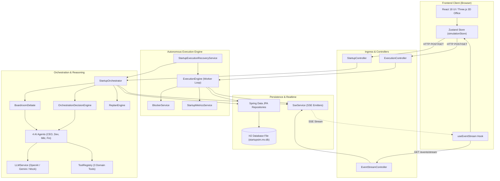
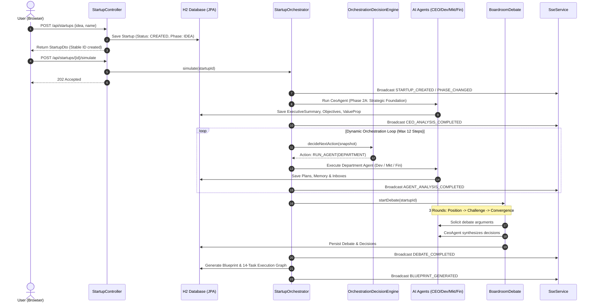
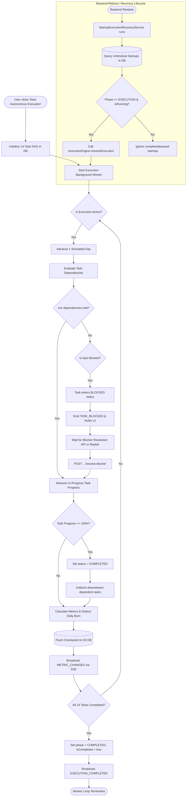

# Autonomous Virtual Startup Simulator
## System Architecture & Technical Specification

**Course/Assessment:** Continuous Assessment 3 (CA3)
**Document Reference:** `docs/ca3/02_SYSTEM_ARCHITECTURE.md`
**System Architecture:** Decoupled Client-Server (REST + SSE) with Autonomous Multi-Agent Backend

---

## 1. System Overview
The **Autonomous Virtual Startup Simulator** is an event-driven, multi-agent platform designed to model early-stage startup dynamics. It decomposes the startup journey into two interconnected phases:

1. **Strategic Planning & Formulation (Phases 1–7):** An interactive multi-agent pipeline where specialized AI agents (CEO, Development, Marketing, Finance) perform domain reasoning, communicate through inboxes, debate in a virtual boardroom, and assemble a comprehensive startup blueprint.
2. **Autonomous 90-Day Execution Engine (Phase 2F):** A server-side background worker that executes a dependency-aware task graph over 90 simulated calendar days, modeling engineering velocity, marketing campaign rollouts, financial cash burn, and obstacle resolution.

The backend is authoritative: all agent states, reasoning traces, task graphs, metrics, and event histories are persisted in a relational database. The frontend is a reactive Single Page Application (SPA) providing real-time 3D spatial visualization and state introspection.

---

## 2. High-Level Architecture & Layer Breakdown

The system is organized into clean, decoupled horizontal layers:

```
+-----------------------------------------------------------------------+
|                         PRESENTATION LAYER                            |
|  React 18 SPA (Vite, TypeScript, Tailwind CSS, Three.js / R3F)        |
|  - 3D Virtual Office Scene (OfficeScene.tsx, Employee3D.tsx)          |
|  - Dashboards (ExecutionDashboard, TasksSidebar, HealthSidebar)       |
|  - Centralized Store: Zustand (simulationStore.ts)                    |
+-----------------------------------------------------------------------+
                                  │   ▲
         HTTP REST (JSON Requests)│   │ Server-Sent Events (SSE Stream)
                                  ▼   │
+-----------------------------------------------------------------------+
|                         API & INGRESS LAYER                           |
|  Spring Boot Web MVC Controllers:                                     |
|  - StartupController (/api/startups)                                  |
|  - ExecutionController (/api/startups/{id}/execution)                 |
|  - EventStreamController (/api/startups/{id}/events/stream)           |
+-----------------------------------------------------------------------+
                                  │
                                  ▼
+-----------------------------------------------------------------------+
|                    ORCHESTRATION & REASONING LAYER                    |
|  - StartupOrchestrator: High-level planning workflow coordinator      |
|  - OrchestrationDecisionEngine: Dynamic LLM-driven action selector    |
|  - BoardroomDebate: 3-round debate moderator (Position/Challenge/Conv)|
|  - ReplanEngine & ReplanValidator: Adaptive graph replanning          |
|  - 4 Specialized Agents: CeoAgent, DeveloperAgent, MarketingAgent,    |
|                         FinanceAgent                                  |
|  - LLM Services: OpenAiLLMService, GeminiLLMService, MockLLMService   |
|  - Tool Infrastructure: ToolRegistry, AgentToolReasoner               |
|  - Memory Subsystem: AgentMemoryContextBuilder, MemoryService         |
+-----------------------------------------------------------------------+
                                  │
                                  ▼
+-----------------------------------------------------------------------+
|                   AUTONOMOUS EXECUTION ENGINE LAYER                   |
|  - ExecutionEngine: Background day-by-day scheduler worker            |
|  - BlockerService: Blocker detection, dependency check, audit resume  |
|  - StartupMetricsService: Mathematical progress & runway calculator   |
|  - StartupExecutionRecoveryService: ApplicationRunner reboot recovery |
+-----------------------------------------------------------------------+
                                  │
                                  ▼
+-----------------------------------------------------------------------+
|                         PERSISTENCE LAYER                             |
|  Spring Data JPA / Hibernate Repositories:                            |
|  StartupRepository, ExecutionTaskRepository, AgentMessageRepository,   |
|  AgentMemoryRepository, ExecutionTraceRepository, EventRepository     |
|  - Persistent Relational Database: File-based H2 Engine (startupsim)  |
|    (Production-ready for PostgreSQL)                                  |
+-----------------------------------------------------------------------+
```

---

## 3. Actual Responsibilities of the Four AI Agents

Each agent inherits from `DepartmentAgent.java` (which extends `AbstractStartupAgent.java`), except the CEO agent which is defined in `CeoAgent.java`.

### 1. CEO Agent (`CeoAgent.java`)
* **Identity:** Ava / Alex Vance (Chief Executive Officer).
* **Mandate:** Executive vision, strategic alignment, debate synthesis, and authoritative decision-making.
* **Core Responsibilities:**
  * Analyzes the founder's initial raw idea to establish the problem statement, solution concept, target audience, value proposition, and business model.
  * Formulates strategic objectives and core assumptions to be validated.
  * Moderates boardroom debates and synthesizes final decisions from the convergence round (`CEO_SYNTHESIS`).
  * Conducts final milestone reviews during execution (Task #14: Product-Market Fit & Milestone Review).

### 2. Development Agent (`DeveloperAgent.java`)
* **Identity:** Devin / Dev Lead / Backend Engineer (Head of Engineering).
* **Mandate:** Technical feasibility, architecture, system stack, effort estimates, and implementation tasks.
* **Core Responsibilities:**
  * Selects the technical stack (e.g., React Native, Node.js, Express, MongoDB, TensorFlow) based on constraints.
  * Defines core MVP features and technical architecture.
  * Discovers and invokes the `development_effort_estimator` tool to generate realistic developer-month forecasts.
  * Executes engineering tasks during execution: Repo/Environment Setup (Task #2), Core Database & API Infrastructure (Task #3), MVP feature implementations (Tasks #4–6), and QA/Security audits (Task #7).

### 3. Marketing Agent (`MarketingAgent.java`)
* **Identity:** Mara / Marketing Lead / Growth Lead (Head of Marketing & Growth).
* **Mandate:** Audience persona definition, competitive positioning, acquisition channels, and go-to-market rollout.
* **Core Responsibilities:**
  * Profiles primary customer personas and demographic traits.
  * Identifies primary growth channels (e.g., social media, skincare community forums, influencer partnerships).
  * Designs conversion funnels and product positioning statements.
  * Executes marketing roadmap tasks: Brand Identity Framework (Task #8), Landing Page & Conversion Funnel (Task #9), and Launch Campaigns (Task #10).

### 4. Finance Agent (`FinanceAgent.java`)
* **Identity:** Finn / Finance Director / Controller (Chief Financial Officer).
* **Mandate:** Fiscal discipline, financial modeling, capital allocation, burn rate, runway, and unit economics.
* **Core Responsibilities:**
  * Models initial capital allocation across engineering, marketing, operations, and reserve buffer.
  * Invokes the `financial_calculator` and `pricing_revenue_calculator` tools to estimate monthly burn rates and runway in months.
  * Defines pricing tiers (e.g., freemium with premium analytics) and validates Customer Acquisition Cost (CAC) against Lifetime Value (LTV).
  * Executes financial tasks: Capital Allocation & Banking (Task #11), Pricing Model Audit (Task #12), and Operating Burn Controls (Task #13).

---

## 4. Inter-Agent Communication & Information Sharing

Agents do not rely on hardcoded shared memory variables; they communicate using structured, auditable protocols:

### A. Target-Addressed Messaging (`AgentMessage.java` & `AgentInbox.java`)
* **Structure:** Each message contains `id`, `startupId`, `sender` (AgentType), `targetAgent` (AgentType), `subject`, `content`, `debateId`, `debateRound`, `consumed` (boolean flag), and `createdAt`.
* **Delivery:** Delivered to the recipient’s dedicated inbox queue (`AgentInbox`).
* **Context Influence:** When an agent prepares to reason, unread messages in its inbox are injected into the LLM prompt. For example, if Finance sends a warning message about runway constraints to Development, the Development prompt incorporates that message so the engineer scales down infrastructure plans.

### B. Persistent Memory Subsystem (`AgentMemory.java` & `AgentMemoryContextBuilder.java`)
* **Memory Scopes:**
  1. `AGENT_PRIVATE`: Private departmental notes, past observations, and internal decisions.
  2. `STARTUP_SHARED`: Company-wide decisions, constraints, and confirmed milestones accessible to all agents.
* **Ranking & Retrieval:** When an agent is prompted, `AgentMemoryContextBuilder` fetches memories ranked by `importance` (1–10) and recency, enforcing strict token bounds so prompts remain focused.

### C. Shared Context DTOs (`StartupContext.java`)
* Aggregates the startup entity, department plans (`TechnicalPlan`, `MarketingPlan`, `Budget`), active execution graph, and past decisions into a single typed snapshot.

---

## 5. Dynamic Orchestration Engine

Unlike static procedural scripts that execute in a fixed sequence (`CEO → Dev → Marketing → Finance`), this project features a **Dynamic Orchestration Engine** (`OrchestrationDecisionEngine.java`).

### A. State Snapshot Assembly (`OrchestrationStateSnapshotFactory.java`)
Before every decision, the factory builds an immutable snapshot containing:
* Completed agent analyses vs. pending agents.
* Recent inter-agent messages and unread counts.
* Accumulated persistent memories and past decisions.
* Current phase and blocker states.

### B. LLM Decision Making & Closed Action Set
The LLM evaluates the snapshot against three valid `OrchestrationAction` choices:
1. `RUN_AGENT`: Selects a specific pending agent whose dependencies are met (e.g., running `FINANCE` after `CEO`).
2. `START_DEBATE`: Initiates a boardroom debate if department findings contain conflicting assumptions.
3. `COMPLETE_ANALYSIS`: Wraps up Phase 2 when all necessary departmental analyses have converged into a viable blueprint.

### C. Server-Side Safety Validation (`OrchestrationDecisionValidator.java`)
The server authoritatively validates every LLM decision before execution:
* Rejects `RUN_AGENT` if the requested agent has already executed or is invalid.
* Rejects `COMPLETE_ANALYSIS` if critical departments have not yet submitted findings.
* **Iteration Bound:** Hard upper bound of `MAX_ORCHESTRATION_STEPS = 12` ensures the simulation never enters an infinite LLM loop.
* **Deterministic Fallback:** If the LLM provider fails in `REAL` mode, explicit failure is recorded; in `SCRIPTED_DEMO` mode, a deterministic fallback path executes.

---

## 6. The 90-Day Autonomous Execution Engine

Once the startup blueprint is generated, the simulation transitions to Phase 2F: Autonomous Execution (`ExecutionEngine.java`).

### A. The Persistent Task Graph (`ExecutionTask.java`)
* Tasks are stored in relational storage with explicit fields: `id`, `startupId`, `department`, `assignedAgent`, `title`, `description`, `priority`, `status` (`PENDING`, `IN_PROGRESS`, `BLOCKED`, `COMPLETED`), `progress` (0.0–100.0), `dependencies` (array of prerequisite task IDs), `estimatedDays`, `actualDays`, and `blockerReason`.
* Tasks represent a Directed Acyclic Graph (DAG). A task cannot transition from `PENDING` to `IN_PROGRESS` until all IDs in its `dependencies` list have reached `COMPLETED`.

### B. Autonomous Server-Side Worker Loop
* Driven by `@Qualifier("simulationScheduler") Executor executor` on a dedicated thread pool.
* Guarded by `ConcurrentHashMap<Long, Boolean> activeExecutionWorkers` to prevent duplicate background threads.
* Advances one simulated calendar day every tick (default: 1.2 seconds), independent of the browser.
* For each active task, increments progress based on duration: `progress += (100.0 / estimatedDays)`.
* When a task reaches 100%, it transitions to `COMPLETED`, unblocking downstream tasks.

### C. Dynamic Metrics Calculation (`StartupMetricsService.java`)
Every simulated day, metrics are recalculated:
* **Overall Progress:** Weighted average of progress across all roadmap tasks.
* **MVP Progress:** Progress specifically computed from Development tasks.
* **Financial Health & Runway:** Decrements `budgetRemaining` each day based on daily burn rate: `budgetRemaining -= (monthlyBurn / 30.0)`. Computes remaining `runwayMonths`.

### D. Blocker Diagnosis & Audited Resolution (`BlockerService.java`)
* Execution can encounter simulated calendar risks (e.g., technical risk reviews on Day 8) or missing prerequisites.
* When blocked, task status mutates to `BLOCKED`, the agent enters `BLOCKED` state, and an alert event is broadcast.
* **Resolution Path:** `POST /api/startups/{id}/execution/tasks/{taskId}/resolve-blocker` verifies that prerequisites are met and clears the blocker, allowing the worker to resume without fabricating progress.

### E. Dynamic Replanning (`ReplanEngine.java`)
* If an obstacle cannot be resolved simply, the `ReplanEngine` proposes a `ReplanProposal` containing typed mutations (`ADD_TASK`, `MODIFY_TASK`, `DEFER_TASK`, `CANCEL_TASK`, `ADD_DEPENDENCY`).
* `ReplanValidator` checks for circular dependencies (cycle detection). Once validated, `TaskPlanMutationService` alters the task graph in the database, allowing execution to route around the failure.

---

## 7. Database Persistence & Restart Recovery

### A. File-Based H2 Relational Persistence
* Database URL: `jdbc:h2:file:./data/startupsim`
* Canonicalized by `DotenvLoader.ensureStableDatabasePath()` so whether started from `flexi/` or `flexi/backend/`, it writes to the exact same database file (`backend/data/startupsim.mv.db`).
* Data survives application shutdowns, browser restarts, and server reboots.

### B. Restart Recovery Lifecycle (`StartupExecutionRecoveryService.java`)
* Implements Spring Boot’s `ApplicationRunner`, executing immediately upon backend startup.
* Queries the database for unfinished startups:
  ```java
  startupRepository.findBySimulationStartedTrueAndSimulationCompletedFalse();
  ```
* **Intelligent Routing:**
  * If interrupted during planning (`phase != EXECUTION && phase != BLUEPRINT`): queues planning recovery via `startupOrchestrator.resumeSimulation(id)`.
  * If interrupted during active execution (`status == RUNNING && phase == EXECUTION`): resumes the execution background worker via `executionEngine.resumeExecution(id)`.
  * Completed, paused, or failed startups are ignored to prevent unwanted duplicate execution.

---

## 8. Real-Time Event Streaming: Server-Sent Events (SSE)

### A. Backend Broadcast (`SseService.java`)
* Client connects to `GET /api/startups/{id}/events/stream`.
* Backend registers an `SseEmitter` with a 30-minute timeout in `ConcurrentHashMap<Long, List<SseEmitter>> emittersByStartup`.
* Whenever an agent speaks, a task progresses, a metric updates, or a blocker occurs, `SseService.broadcast(startupId, event)` serializes a `StartupEventDto` to connected browser clients.

### B. Frontend Consumption & Reconnection Rehydration (`useEventStream.ts`)
* Uses standard browser `EventSource`.
* Listens for `startup-event` messages and updates the Zustand store (`simulationStore.ts`).
* **Genuine Reconnection Detection:** If the backend restarts, the SSE connection drops (`onerror`). When the browser reconnects, `useEventStream` detects a genuine reconnection and immediately triggers `load(activeId)` to rehydrate the entire startup snapshot (tasks, agents, execution state, events, blueprint) from the database.

---

## 9. Supported Software Design Patterns

The codebase applies established enterprise design patterns:

1. **Repository Pattern:** Spring Data JPA repositories (`StartupRepository`, `ExecutionTaskRepository`, `AgentMessageRepository`) encapsulate SQL/HQL operations and provide typed data access.
2. **Factory Pattern:** `OrchestrationStateSnapshotFactory.java` encapsulates the complex logic of assembling immutable, read-only simulation state snapshots from multiple entities.
3. **Strategy / Provider Pattern:** `LLMService.java` defines the interface; `OpenAiLLMService`, `GeminiLLMService`, and `MockLLMService` implement alternative AI generation strategies selected via environment variables.
4. **Observer / Pub-Sub Pattern:** `SseService.java` acts as the publisher broadcasting simulation events to multiple connected browser observers via Server-Sent Events.
5. **State Pattern / Finite State Machine:** Managed transitions across `SimulationPhase` (`IDEA → ANALYSIS → DEBATE → DECISION → PLAN → BLUEPRINT → EXECUTION → COMPLETED`) and `TaskStatus` (`PENDING → IN_PROGRESS → BLOCKED → COMPLETED`).
6. **Command Pattern:** `OrchestrationActionExecutor.java` and `TaskPlanMutationService.java` treat decisions and replan proposals as executable commands with separate validation and execution steps.
7. **Builder Pattern:** Extensively used via Lombok `@Builder` on DTOs and entity models (e.g., `ExecutionStateDto`, `OrchestrationStateSnapshot`) for immutable object construction.

---

## 10. Architecture Diagrams (Mermaid)

### Diagram 1: System Component Architecture


---

### Diagram 2: Startup Creation & Planning Sequence Diagram


---

### Diagram 3: Autonomous Execution & Restart Recovery Flowchart


---

## 11. Viva Voce Explanation Guide: How to Explain These Diagrams

When presenting these diagrams to your college project evaluator, use these simple, direct talking points:

### How to Explain Diagram 1 (Component Architecture):
> *"Sir/Madam, our project uses a decoupled client-server architecture. The frontend is built in React and Three.js, but all business logic, AI reasoning, and simulation rules live strictly on the Spring Boot backend. The user interacts through REST APIs to create startups and control execution, while the backend continuously streams live simulation updates back to the browser using Server-Sent Events (SSE). The backend has four distinct layers: the REST API layer, the multi-agent reasoning layer, the background execution engine, and the Spring Data JPA persistence layer backed by an H2 database file."*

### How to Explain Diagram 2 (Planning & Orchestration Sequence):
> *"This sequence diagram shows how an idea turns into a startup. First, as soon as the founder types an idea, we persist it to the database so it gets a stable ID and cannot disappear. Next, the CEO agent runs initial strategic analysis. Then, instead of hardcoding a fixed sequence, our Orchestration Decision Engine inspects the global state and dynamically decides which department agent should speak next. After all departments analyze the idea, they enter a 3-round Boardroom Debate where they challenge each other’s plans before the CEO synthesizes the final decisions into a complete startup blueprint."*

### How to Explain Diagram 3 (Autonomous Execution & Recovery Flowchart):
> *"This flowchart demonstrates how our 90-day autonomous execution works without relying on the browser. When execution starts, a dedicated background thread pool advances the simulation day-by-day. It manages a Directed Acyclic Graph of 14 tasks with strict prerequisites. Every simulated day, it increments task progress, deducts operating burn from the budget, updates metrics, and saves the state to the database. If a task hits a risk or blocker, it safely pauses that department until an audited resolution or replan occurs. If the backend server is restarted mid-execution, our `StartupExecutionRecoveryService` detects the interrupted startup in the database and automatically resumes the execution worker from its exact checkpoint."*

---

## 12. Verification & Traceability Matrix

| Architectural Feature | Code Evidence / Actual Class | Verification Status |
| :--- | :--- | :--- |
| **Decoupled REST API** | `StartupController.java`, `ExecutionController.java` | Confirmed by code inspection & live curl requests |
| **Realtime SSE Stream** | `EventStreamController.java`, `SseService.java`, `useEventStream.ts` | Confirmed by 5 unit tests in `useEventStream.test.tsx` |
| **4 Specialized Agents** | `CeoAgent`, `DeveloperAgent`, `MarketingAgent`, `FinanceAgent` | Confirmed in `com.startupsimulator.agent.*` |
| **Addressed Messaging** | `AgentMessage.java`, `AgentInbox.java` | Confirmed by `AgentCommunicationTest.java` |
| **Dynamic Orchestrator** | `OrchestrationDecisionEngine.java`, `OrchestrationActionExecutor.java` | Confirmed by `DynamicOrchestrationRuntimeTest.java` |
| **90-Day Execution Engine** | `ExecutionEngine.java` | Confirmed by live execution to Day 56 (100% completion) |
| **Blocker Resolution** | `BlockerService.java` | Confirmed by `BlockerServiceTest.java` & live curl resolution |
| **Task Graph Replanning** | `ReplanEngine.java`, `ReplanValidator.java` | Confirmed by `AdaptiveExecutionTest.java` |
| **Database Persistence** | Spring Data JPA + `./data/startupsim.mv.db` | Confirmed by H2 database file persistence |
| **Restart Recovery** | `StartupExecutionRecoveryService.java` | Confirmed by `ExecutionRestartRecoveryTest.java` |

### Items Flagged for Evaluator Clarification
* **Simulated vs. Real-world Deployment:** The system simulates technical feature delivery and synthetic market metrics; it does not deploy actual commercial code to production app stores or charge real bank accounts.
* **LLM Provider Cost/Quota:** In `REAL` mode, OpenRouter/OpenAI API keys must have active credit. In offline environments, the system seamlessly uses `SCRIPTED_DEMO` mode with zero external dependencies.
