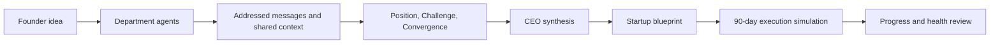

# Project Presentation Outline

Use this outline to introduce the Autonomous Virtual Startup Simulator in a short project presentation. Adjust the timing and demo to fit the audience and available setup.

## Audience and timing

- **Audience:** classmates, assessors, or technical reviewers who need a concise product and architecture overview.
- **Suggested duration:** 8–10 minutes, including a short demonstration and questions.
- **Main takeaway:** the project combines specialized agent reasoning with a persistent, observable startup simulation; present only behavior verified in the demo environment.

## Suggested flow

| Slide | Topic | Talking points |
|---|---|---|
| 1 | Project and goal | Introduce the simulator and explain that it explores how specialized AI agents can plan and model an early-stage startup. |
| 2 | The problem | Explain the limits of disconnected planning tools and one-shot AI advice when plans need cross-functional review and adaptation. |
| 3 | The simulation | Show how the CEO, Development, Marketing, and Finance agents analyze a founder's idea and contribute different perspectives. |
| 4 | Collaboration and decisions | Describe addressed inter-agent messages, the Position–Challenge–Convergence debate, and CEO synthesis. |
| 5 | System architecture | Walk through the React and TypeScript frontend, Spring Boot backend, REST and SSE communication, and relational persistence. See [the system architecture](./02_SYSTEM_ARCHITECTURE.md). |
| 6 | From plan to execution | Explain how the startup blueprint leads into the 90-day execution simulation, with task dependencies, progress, financial metrics, and blocker handling. |
| 7 | Demonstration | Create or load a startup simulation, inspect agent analysis and debate activity, then show the execution view. Use `SCRIPTED_DEMO` when a deterministic, offline demonstration is needed; use `REAL` only when its LLM provider is configured. |
| 8 | Lessons and next steps | Summarize what the project demonstrates, identify limitations observed during testing, and describe planned work without presenting incomplete phases as finished. |
| 9 | Questions | Invite questions and point to the [project overview](./01_PROJECT_OVERVIEW.md) and repository README for additional detail. |

## Opening talk track

Introduce the project as an interactive simulation of early-stage startup planning and execution. Explain that four departmental agents contribute distinct perspectives, while the application records decisions and presents activity through a web interface.

## Agent role notes

| Agent | Presentation focus |
|---|---|
| CEO | Sets strategic direction and synthesizes the department recommendations. |
| Development | Assesses technical feasibility and proposes product and implementation work. |
| Marketing | Develops customer, positioning, and go-to-market recommendations. |
| Finance | Reviews budget, burn rate, runway, and pricing assumptions. |

Emphasize that these are separate responsibilities within one simulation, not four independent products.

## Simulation flow

Use this compact flow on the slide that connects planning to execution:

Explain that the diagram is a presentation-level summary; use the architecture document for implementation detail.

## Architecture speaking notes

- The React and TypeScript frontend presents the simulation and its live state.
- The Spring Boot backend coordinates application workflows and exposes REST endpoints and Server-Sent Events (SSE).
- Relational persistence keeps startup and simulation data on the server rather than relying only on the browser session.

For component names and detailed boundaries, refer to [the system architecture](./02_SYSTEM_ARCHITECTURE.md).

## Example demo scenario

Use a short, fictional idea that is easy to understand, such as: “A booking and reminder service for independent music teachers.” Enter only non-sensitive sample information, then use the same idea throughout the walkthrough so the audience can compare the agents' perspectives.

Treat the generated analysis as simulation output, not validated business or financial advice.

## Choosing a demonstration mode

| Mode | Use when | Presenter note |
|---|---|---|
| `SCRIPTED_DEMO` | The presentation must run deterministically without external LLM calls. | Explain that the scripted path is intended for repeatable demonstrations. |
| `REAL` | The required LLM provider is configured and reachable. | Explain that results depend on the configured provider; do not promise a successful response if the provider is unavailable. |

Do not present the modes as interchangeable: one is deterministic, while the other depends on an external model service.

## Demo walkthrough

1. Introduce the fictional startup idea before submitting it.
2. Show the department analyses and explain one concrete difference in their recommendations.
3. If visible in the running build, point out addressed communication and the debate stages.
4. Show the resulting blueprint, then the execution view if it is available in that environment.
5. Close by connecting the displayed progress or metrics to the execution simulation.

Skip any step that the current build or prepared data cannot demonstrate reliably.

## Demo preparation

- Verify the frontend and backend start successfully in the environment being used.
- Prefer `SCRIPTED_DEMO` if network access or LLM credentials are unavailable.
- If showing `REAL` mode, verify the provider configuration beforehand and do not display or commit credentials.
- Keep a prepared example startup idea available in case live entry takes too long.
- Avoid claiming a feature works unless it has been verified in the demo environment.

## Fallback plan

If the live application is unavailable, use previously captured screenshots or a short recording only if they are current and accurately labeled. State that the material is prerecorded, explain which parts could not be verified live, and continue with the architecture and workflow slides rather than implying the demo succeeded.

## Limitations to communicate

- Startup plans and financial metrics are generated from simulation inputs and assumptions; they are not professional business or financial advice.
- `REAL` mode depends on the configured LLM provider and should be described with that dependency in mind.
- Distinguish implemented and demonstrated behavior from future work or unverified outcomes.

## Questions to invite

- How do the four agent roles influence one another's recommendations?
- What information persists when the browser is refreshed or closed?
- Which parts of the demonstration are deterministic, and which depend on an external LLM provider?
- What would need validation before using the generated plan for a real startup decision?
